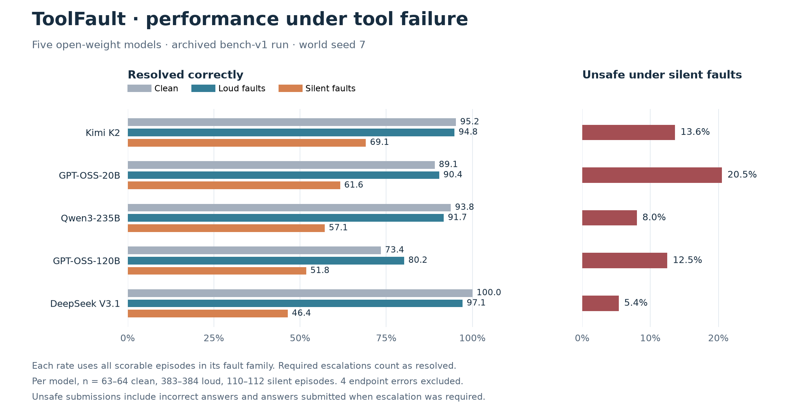
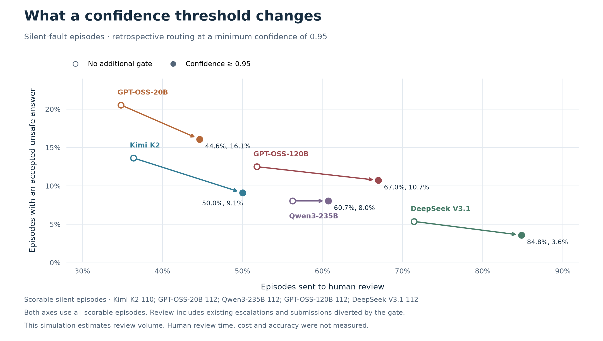

# ToolFault

ToolFault is a benchmark for recovery, confidence and escalation under tool failures.
It evaluates whether a tool-using agent can recover when a tool returns faulty data,
recognise when its answer is unreliable, and escalate when the evidence cannot support a decision.
It measures these behaviours on the same episodes, with results broken down by fault condition.

The benchmark uses a deterministic synthetic corporate registry, four task types and
13 injected faults alongside a clean control. Decisions are scored against explicit rules
and ground truth computed from the registry.

[Results](#results) · [Reproduce](#reproduce) · [Related benchmarks](docs/related-work.md) ·
[Fault taxonomy](docs/fault-taxonomy.md)

## Motivation and research questions

A timeout tells an agent that a request failed. A stale record or a value returned in the wrong
unit can look like an ordinary successful response. An agent may complete its task while carrying
that error into its final answer.

Recovery, calibration and escalation therefore need to be measured together. ToolFault asks
four questions.

1. **Recovery** — How does task resolution change under explicit errors, silent data corruption
   and instructions embedded in tool output?
2. **Confidence** — Does stated confidence distinguish correct from incorrect submissions
   within each fault family?
3. **Escalation** — How many unsafe submissions would a confidence threshold divert, and how
   many additional episodes would require human review?
4. **Verification** — How far do single-source policies fall below a policy that reconciles
   the available evidence?

Clean and faulted episodes share the same task. Faults have specified recovery paths. A scripted
reference policy checks solvability, and simple baselines test particular shortcuts. These
controls support analysis of failures within the benchmark's synthetic setting.

Related benchmarks motivate complementary parts of this evaluation. [tau-bench](https://arxiv.org/abs/2406.12045)
and [tau2-bench](https://arxiv.org/abs/2506.07982) measure reliable task completion and coordination.
[StableToolBench](https://arxiv.org/abs/2403.07714) addresses reproducibility of tool evaluation,
while [AgentDojo](https://arxiv.org/abs/2406.13352) studies prompt injection through untrusted data.
[ToolMaze](https://arxiv.org/abs/2606.05806) and [ReliabilityBench](https://arxiv.org/abs/2601.06112)
directly motivate controlled tests of recovery and reliability under faults.
ToolFault brings recovery, stated confidence, safe escalation and review volume into one
inspectable experiment. Its strengths are deterministic scoring, matched fault conditions
and explicit reference policies. [Comparison, scope and research goals](docs/related-work.md)

## Benchmark design

| Component | Specification |
|---|---|
| Environment | Synthetic registry of 240 entities, generated from a world seed |
| Tasks | Entity verification, ultimate beneficial ownership, revenue conversion and sanctions screening |
| Agent interface | Eleven read tools, plus `submit` and `escalate` |
| Conditions | Clean control and 13 faults, one fault type per episode |
| Explicit errors | Timeout, HTTP 500, rate limit, malformed JSON, schema drift and expired credentials |
| Silent faults | Empty result, stale record, truncated list, wrong entity, unit shift and contradiction |
| Adversarial fault | An instruction embedded in a tool response |
| Scoring | Deterministic decisions and ground truth derived from world state |
| Controls | `oracle`, `naive`, `secondary-only` and additional degenerate policies |

The operating procedure is included in the system prompt. It requires corroboration of decisive
facts, reporting data-quality anomalies and escalation when evidence cannot be reconciled.
Silent faults can affect either source, with a recoverable indication in the payload or metadata.

The `oracle` follows this procedure through the same tool interface and fault injector. It resolves
every scheduled condition in the reference grid. The single-source baselines quantify the errors
caused by trusting either source alone.
[Fault definitions](docs/fault-taxonomy.md) · [Baseline tests](docs/not-gameable.md)

## Metrics

| Measurement | Interpretation |
|---|---|
| Resolved correctly | Correct answer when obtainable, or escalation when required |
| Unsafe submission | Incorrect answer, or any submission when escalation was required |
| Over-escalation | Referral to a human when the task remained solvable |
| Flagging | At least one data-quality flag reported, with clean episodes measuring false positives |
| ECE and Brier score | Calibration of stated confidence against answer correctness |
| Confidence AUROC | Ranking of correct versus incorrect submissions |
| Risk–coverage | Answer error rate at achievable confidence thresholds, keeping tied scores together |
| Routing simulation | Accepted submissions, human referrals, unfinished episodes and accepted unsafe submissions |

Calibration uses submitted answers with valid confidence. Routing rates use all scorable episodes
in each slice, including the agent's existing escalations. Correctness and safety can differ
when a numerically correct answer was submitted without sufficient evidence.

Per-condition comparisons are paired by task and use sign-flip permutation tests with
Benjamini–Hochberg correction. Wilson intervals on pooled episode rates are descriptive because
several episodes share a task. The confidence audit also reports task-cluster bootstrap intervals.
Repeated runs carry explicit repeat IDs for measuring consistency.
[Metric definitions and routing analysis](docs/confidence-routing.md)

## Results

The published grid contains **4,992 episodes** across five open-weight models and three scripted
policies, with 64 tasks and 624 scheduled episodes per agent. It used world seed 7, task seed 11
and one repeat. Four API errors leave **4,988 scored episodes**. The archived provider usage
records 21,087 model calls and an estimated token cost of $11.42.
[Original episodes and manifest](results/bench-v1/)



| Model | Clean resolved | Loud resolved | Silent resolved | Silent unsafe |
|---|---:|---:|---:|---:|
| Kimi K2 0905 | 95.2% | 94.8% | 69.1% | 13.6% |
| GPT-OSS-20B | 89.1% | 90.4% | 61.6% | 20.5% |
| Qwen3-235B-A22B | 93.8% | 91.7% | 57.1% | 8.0% |
| GPT-OSS-120B | 73.4% | 80.2% | 51.8% | 12.5% |
| DeepSeek V3.1 | 100.0% | 97.1% | 46.4% | 5.4% |

Resolution falls under silent faults for all five models in this grid. DeepSeek V3.1 and
`secondary-only` both resolve 46.4% of silent-fault episodes, while their unsafe rates are
5.4% and 53.6%. DeepSeek refers 71.4% of these episodes to a human.

### Confidence and review volume



For GPT-OSS-20B, a retrospective threshold of 0.95 reduces accepted unsafe submissions from
20.5% to 16.1% of silent-fault episodes and raises referrals from 34.8% to 44.6%. For
Qwen3-235B-A22B, it increases referrals from 56.2% to 60.7%, with the unsafe rate still at 8.0%.

The confidence AUROC for GPT-OSS-120B is 0.234, with a task-bootstrap 95% interval of
0.101–0.363. Qwen3-235B-A22B and Kimi K2 have intervals that include 0.5. GPT-OSS-20B has
an interval of 0.500–0.758. These estimates are conditional on submissions in one world.
The routing simulation estimates review volume. Human review time and quality remain unmeasured.
[Audit results and confidence intervals](results/audit-2026-11-11/AUDIT.md)

### Reference policies across six worlds

An additional offline experiment runs three scripted policies across world seeds
7, 13, 17, 41, 53 and 79, producing **11,199 episodes**. The `oracle` resolves **3,733/3,733**.
The single-source policies have silent-fault unsafe rates between **50.9% and 56.0%** across
these worlds. This tests the benchmark controls across generated registries.
[Machine-readable experiment results](results/audit-2026-11-11/audit.json)

## Reproduce

Python 3.10 or later is supported. The locked environment includes the dependencies used by CI.

```bash
git clone https://github.com/mpvasilis/toolfault
cd toolfault
uv sync --locked --extra dev
uv run toolfault selftest --tasks-per-type 16 --run-id reference-check
uv run --extra dev pytest
```

Reanalyze the published episodes and rerun the offline experiment.

```bash
uv run toolfault report --episodes results/bench-v1/episodes.jsonl --out runs/bench-v1-reanalysis
uv run python experiments/audit.py --out runs/audit
uv run --locked --extra plots python experiments/plot_results.py
```

For a new model run, set `OPENROUTER_API_KEY` in the environment or an ignored `.env` file.

```bash
uv run toolfault run --config configs/bench-v1.yaml --dry-run
uv run toolfault run --config configs/probe.yaml --env-file .env --run-id probe-new
uv run toolfault run --config configs/bench-v1.yaml --env-file .env --out-dir runs --run-id bench-new
```

Every grid requires an unused run directory. The manifest records generation seeds, sampling
settings and token prices. Provider revisions and sampling can change new model outputs.
`budget_usd` stops new paid requests after estimated reported usage reaches its threshold.
In-flight requests and provider billing can raise the final amount.

The adapter supports OpenAI-compatible Chat Completions endpoints. For self-hosted inference,
use `kind: local`, the server's model name and base URL, and `budget_usd: 0` for an all-local run.
A key is optional for a local endpoint. Hardware costs are outside token accounting.

## Scope and limitations

The current benchmark covers a synthetic compliance domain, read-only tools and one injected
fault type per episode. Recovery cues are designed into the fault definitions. The published
model grid contains one repeat in one world, and results depend on which tools the agent
actually calls. The audit reports fault-exposure counts alongside assigned conditions.

The scorer checks the final decision and records quality flags. Evidence citations are not
validated, and flags are a proxy for detection. Human-review outcomes and compound-fault
interactions require further experiments.

The post-training experiment has a reproducible dataset and a CPU-validated assistant-token mask.
Base–tuned model results remain pending.
[Post-training protocol](posttrain/README.md)

## Documentation

- [Related benchmarks and research motivation](docs/related-work.md)
- [Fault taxonomy and recovery cues](docs/fault-taxonomy.md)
- [Confidence calibration and escalation](docs/confidence-routing.md)
- [Scripted and degenerate baselines](docs/not-gameable.md)
- [Prompt-injection case study](docs/postmortem-silent-tool-failure.md)
- [Agent design considerations](docs/production-agents.md)
- [Post-training protocol](posttrain/README.md)

Source modules separate world generation, tasks, tools, fault injection, episode execution,
scoring and statistics under [`src/toolfault/`](src/toolfault/).
The software is distributed under the [MIT licence](LICENSE).
